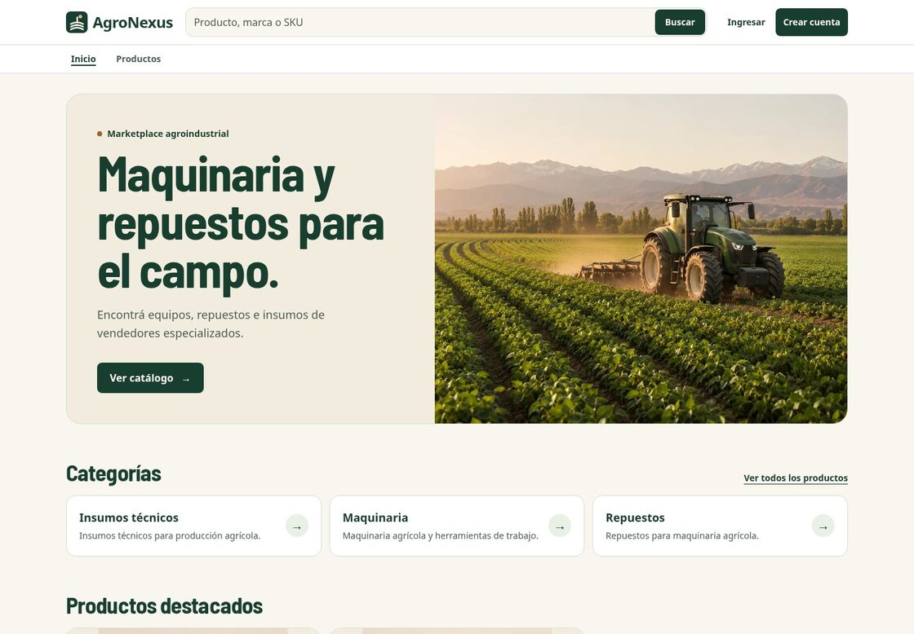

# AgroNexus

[](https://github.com/diego21-portal/agronexus/actions/workflows/backend-ci.yml)
[](https://github.com/diego21-portal/agronexus/actions/workflows/frontend-ci.yml)
[](https://github.com/diego21-portal/agronexus/actions/workflows/docker-build.yml)

AgroNexus es un marketplace agroindustrial con frontend React y TypeScript y API Django REST Framework. Permite recorrer el catálogo, comprar a varios vendedores y gestionar pedidos, inventario y posventa desde portales de cliente, vendedor y administración.

Es un proyecto de portafolio con pagos, reembolsos y eventos logísticos simulados. La versión 1.1.1 mejora la recuperación de compras, la navegación por teclado y la lectura con texto ampliado. Consulta el [historial de cambios](CHANGELOG.md) y la [guía de actualización](docs/cierre-v1.md).

## Probar la demo

Desde la raíz del repositorio, con Docker Desktop o Docker Engine y Compose v2:

```bash
docker compose -f ops/compose.demo.yml up --build --wait
```

Abre [AgroNexus](http://127.0.0.1:8088). El comando compila React, inicia PostgreSQL, aplica migraciones y carga datos de ejemplo en el primer arranque. Los siguientes arranques conservan las cuentas y operaciones guardadas. La demo escucha en `127.0.0.1` y usa volúmenes propios.

La portada y el catálogo usan ilustraciones generadas para la demostración. Si actualizás una demo que ya tiene datos, podés añadir las ilustraciones a sus productos de ejemplo sin reemplazar las imágenes existentes.

```bash
docker compose -f ops/compose.demo.yml exec web python manage.py seed_demo --images-only
```

| Cuenta de prueba | Correo | Contraseña |
|---|---|---|
| Cliente | `cliente@agronexus.com` | `Demo123456` |
| Cliente con envío en tránsito | `cliente2@agronexus.com` | `Demo123456` |
| Vendedor | `vendedor@agronexus.com` | `Demo123456` |
| Administración | `admin@agronexus.com` | `Demo123456` |

Estas cuentas pertenecen a la demo local. El [despliegue en servidor](docs/despliegue.md) usa configuración y credenciales propias.

Para recorrer la posventa, entra como segundo cliente y abre el pedido `AGX-DEMO-0003` en **Mis pedidos**. Solicita la cancelación del envío. Entra como vendedor para confirmar el retorno y registrar la recepción e inspección. Administración completa el reembolso simulado. También puedes explorar el [catálogo](http://127.0.0.1:8088/products) y la [API interactiva](http://127.0.0.1:8088/api/v1/docs/).



[Vista del portal vendedor con los datos de la demo](docs/vista-vendedor.jpg)

Para detener la demo preservando los datos:

```bash
docker compose -f ops/compose.demo.yml down
```

Si el puerto `8088` está ocupado, en PowerShell ejecuta `$env:AGRONEXUS_DEMO_PORT="8089"` antes del arranque y abre `http://127.0.0.1:8089`. En Bash puedes iniciar el comando con `AGRONEXUS_DEMO_PORT=8089`.

## Funcionalidades

- Catálogo público con búsqueda, filtros, categorías, marcas, regiones, imágenes y fichas técnicas.
- Registro, perfil, direcciones y sesiones JWT revocables con rotación de refresh y coordinación entre pestañas.
- Carrito y checkout transaccional, validación de stock y pedidos con envíos por vendedor.
- Portal vendedor con productos, imágenes, ficha PDF, inventario, pedidos, seguimiento y preguntas.
- Favoritos, reseñas de compras entregadas, reclamos y notificaciones internas.
- Cancelaciones y devoluciones con recepción, inspección, reposición de unidades aptas y reembolsos simulados auditables.
- Paneles de vendedor y administración con métricas de la API, ingresos netos simulados y permisos por rol.
- Alta comercial de vendedores desde administración, con datos requeridos y reactivación explícita de perfiles inactivos.

El rol de operador logístico existe en el modelo, pero todavía no tiene un portal operativo propio. Los flujos y sus límites se describen en [cancelaciones y devoluciones](docs/cancelaciones-devoluciones.md), [envíos del vendedor](docs/envios-vendedor.md), [sesiones](docs/sesiones.md) y [compra e historial](docs/compra-historial.md).

## Estructura y tecnologías

```text
backend/                 Django 5.2, DRF, PostgreSQL/SQLite, JWT, pytest
frontend/                React 19, TypeScript, Vite, Tailwind, Vitest, Playwright
docs/                    Flujos, contratos y guías operativas
ops/                     Compose de demo local y plantilla de producción con TLS
.github/workflows/       Calidad frontend, PostgreSQL, E2E y build Docker
```

Requisitos locales: Python 3.12, Node.js 24 y npm. La CI utiliza Node.js 24. Usa PostgreSQL para verificar transacciones y concurrencia; SQLite permite una primera ejecución local.

Las dependencias de JavaScript pertenecen a `frontend/package.json` y `frontend/package-lock.json`. Ejecuta `npm ci` **desde `frontend/`**. No existe un workspace npm en la raíz ni se versionan `node_modules`, builds o cachés.

## Inicio local

Ejecuta desde la raíz del repositorio:

```bash
python -m venv backend/.venv
source backend/.venv/bin/activate
python -m pip install -r backend/requirements.txt
```

En PowerShell, la activación es `backend\.venv\Scripts\Activate.ps1`.

Crea `backend/.env` con una clave aleatoria propia y la configuración local:

```env
SECRET_KEY=REEMPLAZAR_POR_UNA_CLAVE_ALEATORIA_LOCAL
DJANGO_SETTINGS_MODULE=config.settings.local
ALLOWED_HOSTS=localhost,127.0.0.1
DB_ENGINE=django.db.backends.sqlite3
DB_NAME=db.sqlite3
CORS_ALLOWED_ORIGINS=http://localhost:5173,http://127.0.0.1:5173
```

Una clave puede generarse con `python -c "from django.core.management.utils import get_random_secret_key; print(get_random_secret_key())"`. Los archivos `.env` son locales y están ignorados por Git. `config.settings.local` activa `DEBUG`; para producción se utiliza otro módulo.

Arranca el backend:

```bash
cd backend
python manage.py migrate
python manage.py seed_demo
python manage.py runserver
```

`seed_demo` es opcional y se utiliza únicamente en una base de demostración. Informa los accesos por consola. Cuando ya hay historial de inventario o posventa protegido, el comando rechaza reconstruirlo incluso con `--reset`: utiliza otra base de demostración para empezar de nuevo.

En otra terminal, desde la raíz:

```bash
cd frontend
npm ci
cp .env.example .env.local
npm run dev
```

En PowerShell, utiliza `Copy-Item .env.example .env.local`. Puedes dejar `VITE_API_BASE_URL` vacío para usar `http://127.0.0.1:8000/api/v1`, o asignar esa URL explícitamente.

| Recurso local | Dirección |
|---|---|
| Aplicación React | http://localhost:5173 |
| Salud de la API | http://127.0.0.1:8000/health/ |
| Documentación API | http://127.0.0.1:8000/api/v1/docs/ |
| Esquema OpenAPI | http://127.0.0.1:8000/api/v1/schema/ |
| Django Admin | http://127.0.0.1:8000/admin/ |

El portal administrativo React usa `/admin` en el origen del frontend. Django Admin utiliza `/admin/` en el origen del backend.

## Backend con Docker y PostgreSQL local

La configuración `backend/docker-compose.yml` es de **desarrollo**: monta el código local, ejecuta `migrate` al arrancar y utiliza `runserver`.

```bash
cd backend
cp .env.example .env.docker
```

Completa `.env.docker` antes de iniciar:

| Variable | Valor local |
|---|---|
| `DJANGO_SETTINGS_MODULE` | `config.settings.local` |
| `SECRET_KEY` | Clave aleatoria propia |
| `ALLOWED_HOSTS` | `localhost,127.0.0.1,web` |
| `CORS_ALLOWED_ORIGINS` | `http://localhost:5173,http://127.0.0.1:5173` |
| `DB_ENGINE` | `django.db.backends.postgresql` |
| `DB_NAME`, `DB_USER`, `DB_PASSWORD` | Valores de `POSTGRES_DB`, `POSTGRES_USER`, `POSTGRES_PASSWORD` del servicio `db` en el Compose local |
| `DB_HOST`, `DB_PORT` | `db`, `5432` |

Las credenciales del Compose local son de demostración. No reutilices ese Compose o sus credenciales para un servicio público.

```bash
docker compose up --build -d
docker compose exec web python manage.py seed_demo
docker compose exec web python manage.py createsuperuser
```

Arranca el frontend por separado con los comandos anteriores. PostgreSQL conserva sus datos en el volumen del Compose; `docker compose down` detiene los servicios sin eliminar ese volumen.

Si conectas Python directamente a ese PostgreSQL desde el host, utiliza `DB_HOST=127.0.0.1` y `DB_PORT=5433`. Dentro de Docker, el puerto sigue siendo `5432`.

## Validación

Desde `backend/`, con el entorno virtual activo y una base de pruebas configurada:

```bash
python manage.py check
python manage.py makemigrations --check --dry-run
python -m pytest
```

Con Docker de desarrollo: `docker compose exec web python -m pytest`. Las pruebas crean su propia base de tests; la cuenta PostgreSQL necesita permiso para crearla. Las pruebas de bloqueo y concurrencia se omiten explícitamente en SQLite y requieren PostgreSQL para verificarse.

Desde `frontend/`:

```bash
npm run quality
npx playwright install --with-deps chromium
npm run e2e
```

`quality` ejecuta ESLint, TypeScript, Vitest y build. El E2E público comprueba navegación de escritorio y móvil; no demuestra por sí solo que una compra funcione contra la API. La suite `npm run e2e:auth` verifica sesiones, compra, vendedor, administración y posventa contra Django real y requiere una base demo aislada y el backend en el puerto `8001`: sigue [la guía del frontend](frontend/README.md).

La CI comprueba Django con PostgreSQL y Ruff, la calidad de React, el build con npm 12 en Windows, la navegación pública, los flujos contra Django, OpenAPI, las dependencias y las imágenes Docker con un smoke HTTPS aislado.

## Actualización y producción

Para integrar el cierre actual en tu entorno, sigue [la actualización de v1.0](docs/cierre-v1.md#actualizar-con-docker-desde-powershell). La [guía de consolidación](docs/consolidacion.md) conserva el contexto del bloque anterior. Para una instalación con datos, crea y comprueba un respaldo antes de migrar, según la [receta de respaldo, auditoría y migración](docs/cancelaciones-devoluciones.md#actualizar-con-docker-desde-powershell). Conserva el código anterior, una copia restaurable de la base y los archivos `media`. Las migraciones que protegen historial o referencias PDF pueden exigir restaurar ese respaldo y su versión de código para retroceder.

La [guía de despliegue](docs/despliegue.md) explica la plantilla de `ops/`: Gunicorn, frontend compilado, Nginx con TLS, PostgreSQL externo mediante `DATABASE_URL` y volúmenes persistentes para media y estáticos. Requiere dominios, certificados e infraestructura propios. Su configuración no publica automáticamente el proyecto.

## Documentación

- [Arquitectura](docs/arquitectura.md) y [modelo de datos](docs/modelo-datos.md).
- [Flujos de negocio](docs/flujos-negocio.md), [roles y permisos](docs/roles-permisos.md) y [endpoints](docs/endpoints.md).
- [Cancelaciones y devoluciones](docs/cancelaciones-devoluciones.md), [sesiones](docs/sesiones.md) y [envíos](docs/envios-vendedor.md).
- [Compra e historial](docs/compra-historial.md), [cierre y actualización de v1.0](docs/cierre-v1.md) y [consolidación anterior](docs/consolidacion.md).
- [Testing](docs/testing.md), [seguridad](docs/seguridad.md) y [despliegue](docs/despliegue.md).

Las integraciones de pago y transporte reales, almacenamiento externo y escalado requieren trabajo e infraestructura adicionales. Las decisiones de autoría y licencia deben ser confirmadas por el titular del proyecto.
